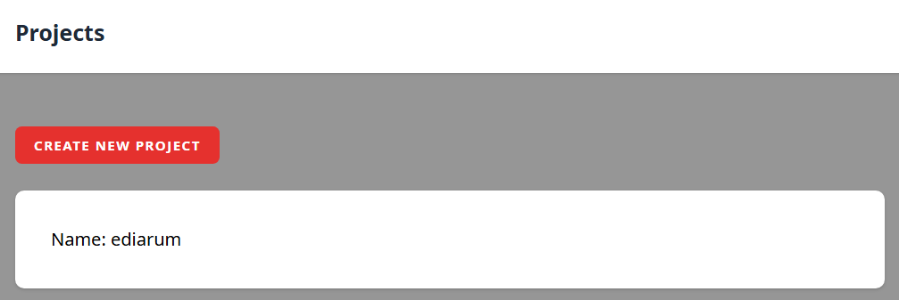
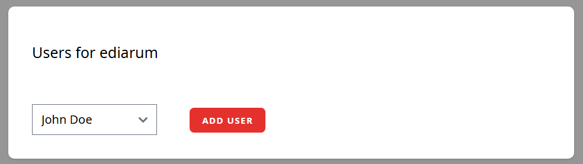
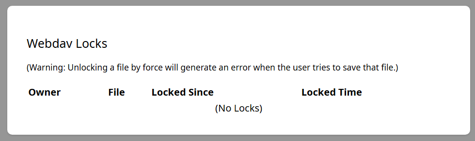
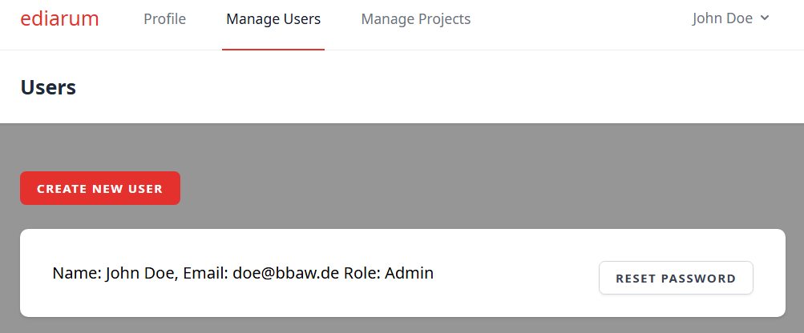

# Usage

## Login

ediarum.WEBDAV's admin pages run inside the ediarum.platform portal: log in on the portal (e.g.
`https://ediarum.example.org/`), then open **WebDAV** in its top bar. The login is the same account
you use for WebDAV itself.

For the first time using ediarum.WEBDAV use the user and password defined in the `.env` file.

(The screenshots in this document show the pages from before the move into the portal; the
content of the WebDAV pages is the same.)

After login there are different options:

* Change your password (the portal's profile page)
* Manage users (Admins only)
* Manage projects (Admins only)

## Understanding Roles and Permissions

### Permission Overview

| Feature | Admin | Regular User |
|---------|-------|---------------|
| **Change Own Password and Name** | ✓ | ✓ |
| **View Assigned Projects** | ✓ All projects | ✓ Assigned projects only |
| **Manage Users** | ✓ Create, reset password, set admin status | ✗ |
| **Manage Projects** | ✓ Create, edit, delete | ✗ |
| **Add/Remove Users to Project** | ✓ | ✗ |
| **WebDAV File Access** | ✓ All projects | ✓ Assigned projects only |
| **View WebDAV Locks** | ✓ | ✗ (read-only own locks) |

### What each role can do

**Admin:**
- Manage which users can access which projects
- Fix WebDAV locks
- See all project activity
- Configure external integrations (Git remote such as GitLab or GitHub, eXist-db)

**Regular User:**
- Access only their assigned projects via WebDAV
- Edit files and synchronize changes automatically
- Request help from Admin to change settings

## Profile

The portal's profile page shows your name and email. You can change your password and your display
name there; the email can't be changed, since it identifies your account.

## Manage projects

Here an admin can add new projects or edit existing ones.



### Add a new project

"Create New Project" asks for:

* **Project Name:** for managing the projects
* **Slug:** lowercase letters and digits, words separated by single hyphens. It names the project's folder on the server and is part of the project's WebDAV URL (`…/webdav/connection/<slug>`). It can't be changed later.
* **Git Remote URL:** URL of the remote Git repository on your Git host (e.g. GitLab or GitHub).
* **Git Username:** Used for authentication on the Git host.
* **Git Personal Access Token:** Access token for the repository, created on the Git host. It must have at least read and write permissions on the repository.
* **Tracked Git Branch:** The branch that is checked out and that WebDAV changes are committed and pushed to.

Saving the form initializes the project (see below). If initializing fails, the project is still created and can be initialized again with "Initialize Project" on its page.

### Edit a project

On the project's page, "Edit" changes the settings above (except the slug) and the integrations:

* **Push to ediarum services?:** Sends every change to the ediarum services. Their URL and token are set server-wide in `.env` (`EDIARUM_SERVICES_URL`, `EDIARUM_SERVICES_API_KEY`).
* **Index app is the source of truth?:** Reported to the platform's other apps (through the service API): whether the index app, rather than the XML files, is the source of truth for this project.
* **eXist-db Base Url:** Used for synchronisation with eXist-db.
* **eXist-db Data Path:** The data path within the eXist-db, e.g. `/db/apps/my-project/data`
* **eXist-db Username:** User with write permissions to eXist-db.
* **eXist-db Password:** User password.

Saved tokens and passwords are never shown again; leave the field blank to keep the saved one.

### The project page

The project page shows the project's WebDAV path, where changes are pushed (Git remote, ediarum services, eXist-db) and the tracked branch. It also has the users of the project, the current WebDAV locks and locked paths, and, depending on the configuration, the sections described below.

If Git commits for the project are failing, the page shows a warning with the last error: WebDAV changes are then saved, but not committed.

#### Setting up a project with a git repository

When a project is created, ediarum.WEBDAV clones its repository from the Git remote and checks out the tracked branch ("Initialize Project"). The repository must have a top-level `data` folder: only that folder is served over WebDAV, and every change made there is saved as a git commit. Where the repository lives on the server is set by the server configuration, not per project.

If one sets up a project with **Git Remote URL**, **Git Username**, and **Git Personal Access Token** (PAT), then all new commits are automatically pushed to the Git remote.

Ensure the branch is not protected against pushes on the Git host. On GitLab: `repository -> Settings -> Repository -> Protected branches`; on GitHub: `repository -> Settings -> Branches` (branch protection rules).

Changing "Tracked Git Branch" in the project settings does not switch the branch on the server: to change it, log in to the server and check out the branch in the project's repository as well.

#### Maintenance mode

"Disable for Maintenance" on the project page turns off WebDAV access to the project for everyone, e.g. while working on the repository on the server. "End Maintenance Mode" turns it back on.

#### Add commits from another branch

With a Git remote configured, "Add Commits From Another Branch" brings the commits of another branch on the Git remote onto the tracked branch. This only works when it is a clean fast-forward; if the branches have diverged, nothing is changed and the other branch must first be rebased onto the tracked branch. The project must be in maintenance mode while the commits are added.

#### Setting up a WebDAV connection

##### Using Oxygen XML Editor (recommended)

1. **Open Oxygen XML**
2. **Window → Show View → Data Source Explorer**
3. **Right-click → New connection**
4. **Choose "WebDAV"**
5. **Enter connection details:**
   - **URL:** `https://your-server.com/webdav/connection/{project-slug}` (the exact URL is shown on the project page as "Ediarum WebDAV Path")
   - **Username:** Your email
   - **Password:** Your password
6. **Click "OK"** and connect

The project files now appear in your Data Source Explorer as a virtual folder.


#### Setting up a synchronisation to eXist-db

If one sets up a project with **eXist-db Base Url**, **Data Path**, **Username**, and **Password** in the project settings, then every change is automatically pushed to eXist-db.

The project page then also offers "Manual eXist-db Synchronization", which uploads the chosen folder (or all contents) to eXist-db again, and lists "Failed Pushes to eXist-db", which can be retried there.

### Add Users to a project

After creating a new project an admin can add and remove users in the project details page.

* For adding select a user and select "Add User".
* For removing select "Remove".

A user can be member of multiple projects. The user only has access to the data files within these projects (e.g. via `https://your-server.com/webdav/connection/project-1`).



### Manage WebDAV locks

In the project details page the current webdav locks are tracked.



#### What are WebDAV locks?

When a user opens a file in WebDAV (e.g., via Oxygen XML Editor), the file is locked to prevent concurrent edits. This lock should be released when the file is closed. However, sometimes locks can remain stuck (e.g., if a user disconnects without properly closing the file).

#### Viewing active locks

The locks table shows:
- **Owner**: Email of the user who locked the file
- **File**: Which file is locked
- **Locked Since**: When the lock was acquired
- **Locked Time**: How long the file has been locked

#### Removing stuck locks

If a lock is stuck (e.g., user closed editor without releasing the lock):
1. Identify the stuck lock in the table
2. Click "Force Unlock"
3. The file can now be edited by other users

**Note:** Use caution - only release locks from users you've confirmed are no longer editing.

### Locked paths

"Locked Paths" blocks all WebDAV edits to the files within a given path of the project, e.g. a folder that should only be changed on the Git remote. Enter the path and click "Lock Path"; "Unlock" removes the lock again.

## Manage Users

Here an admin can add a new user or reset the password for an existing user.



### Add a new user

* Go to `Create new user` and fill in name, email, password.
* If the user should have admin rights (to manage users and projects) check the box "Make the user an Admin?"

*Attention:* Currently this setting can't be changed via the GUI after creating the user. To change this setting you must log in to MySQL and change in your database (e.g. `ediarum_webdav`) in the table `users` the field `is_admin` to `1` (see Working with MySQL Database)

Once you an account is created, it can be used to login via webdav:

* Use the email and password to log in to the WebDAV connection of a project the user is a member of, e.g. `https://your-server.com/webdav/connection/project-1`.

#### Working with MySQL Database

To inspect and modify the database manually, log in to MySQL:

```bash
mysql -u root -p
```

Then select the database:

```sql
USE ediarum_webdav;
```

Useful commands:

* **View all tables:** `SHOW TABLES;`
* **View table structure:** `DESCRIBE users;` or `SHOW COLUMNS FROM users;`
* **View all table data:** `SELECT * FROM users;`
* **Make a user an admin:** `UPDATE users SET is_admin = 1 WHERE id = 1;` (replace `1` with user ID)
* **Remove admin rights:** `UPDATE users SET is_admin = 0 WHERE id = 1;`
* **View specific columns:** `SELECT id, name, email, is_admin FROM users;`

### Reset password for an existing user

* Go to `Reset password` to set a new automatic generated password for a user.

After logging in with the new password the user can change the password on the portal's profile page.

## Using ediarum.WebDAV (for regular users)

### What is ediarum.WebDAV?

ediarum.WebDAV allows version control of the xml-files of your digital editon. Changes are automatically synchronized to a Git remote such as GitLab or GitHub and (optionally) to exist-db for web presentation.

### Setting up a WebDAV connection

#### Using Oxygen XML Editor (recommended)

1. **Open Oxygen XML**
2. **Window → Show View → Data Source Explorer**
3. **Right-click → New connection**
4. **Choose "WebDAV"**
5. **Enter connection details:**
   - **URL:** `https://your-server.com/webdav/connection/{project-slug}` (the exact URL is shown on the project page as "Ediarum WebDAV Path")
   - **Username:** Your email
   - **Password:** Your password
6. **Click "OK"** and connect

The project files now appear in your Data Source Explorer as a virtual folder.

### How synchronization works

When you save changes to a file via WebDAV:

1. **Your editor** → saves to ediarum.WEBDAV
2. **ediarum.WEBDAV** → creates a Git commit with your changes
3. **Git** → automatically pushes to the Git remote (if configured)
4. **eXist-db** → automatically synced (if configured)

This process normally takes a few seconds.

### What you should know

- **File locks:** While you're editing a file, it's locked. Don't keep files open unnecessarily.
